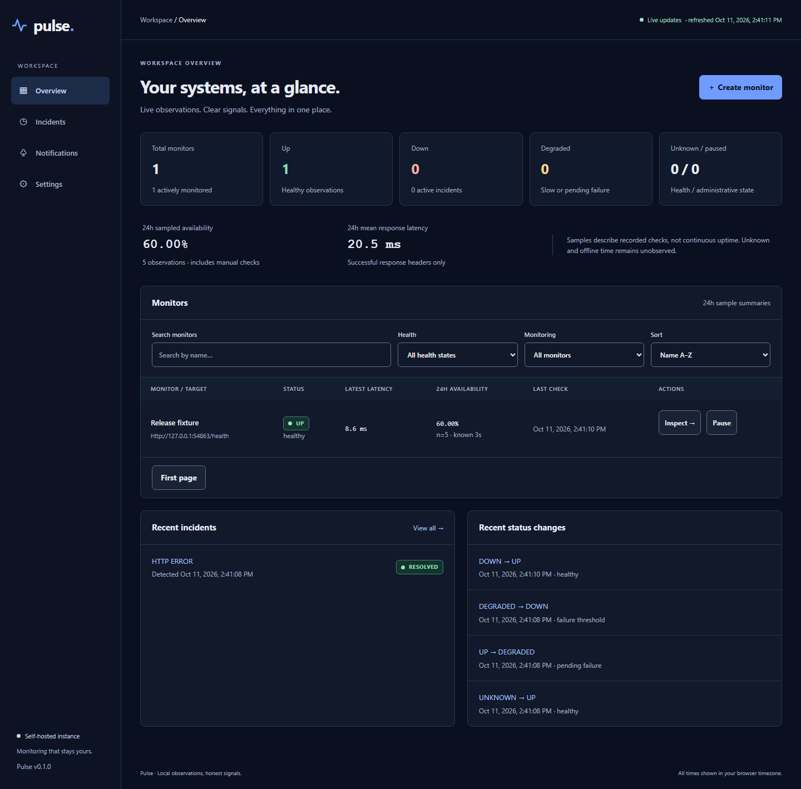

# Pulse

Self-hosted HTTP monitoring with confirmed incidents, qualified history and webhook alerts. Pulse keeps configuration and observations in local SQLite and serves its dashboard and API from one process. No paid service or hosted control plane is required.

**v0.1.0-beta.1 is experimental and is not recommended for critical production monitoring.** This GitHub-only beta has known latency, scheduling and overload limitations. It does not meet the future stable release's performance criteria. See [beta scope and known limitations](docs/guides/BETA.md).



## What Pulse does

- Checks HTTP/HTTPS endpoints with GET or HEAD, expected status codes and configurable timeouts.
- Schedules bounded work without overlapping checks or replaying missed intervals.
- Confirms incidents after consecutive failures and resolves them after consecutive successes.
- Shows current health, paginated history, response-header latency and observation coverage.
- Delivers optional signed webhooks through a persistent queue with finite retries.
- Provides local diagnostics, restart recovery and optional authenticated remote access.

It is useful when a small team needs endpoint observations and a local record of outages without operating a separate database or monitoring control plane. It measures what this instance can observe; it is not an SLA verifier.

## Requirements

Node.js **24.19.0**, npm **11.6.4**, and writable local disk. The engine accepts patched Node 24.x versions from 24.19.0, but each supported patch/platform needs validation. Node 22, 25 and 26 are rejected. Local tests cover Windows x64 and Ubuntu 24.04 x64 userspace on WSL2 with local ext4 storage; the source distribution records exact package results and remaining release gates. macOS/ARM, native Linux hardware capacity and remote deployments are not implicitly certified.

SQLite is supplied by Node; no separate database service is needed. Internet access is needed to install dependencies. The installed application operates without registry access. Avoid network shares and cloud-synced storage.

## Quick start from source

From the source directory:

```sh
npm ci
npm run build
npm start
```

Open http://127.0.0.1:3000. The default listener is loopback-only, with public-only outbound monitoring. The compiled dashboard is served by Pulse; a separate Vite server is unnecessary.

Stop with Ctrl+C. Data persists in `~/.pulse/pulse.sqlite`, independently of your working directory. Existing source users with `./data/pulse.sqlite` must set `PULSE_DATA_DIR` to that directory before startup.

## Installation from the GitHub beta archive

Download `pulse-http-monitor-0.1.0-beta.1.tgz` from the [GitHub pre-release](https://github.com/thebraz/Pulse/releases/tag/v0.1.0-beta.1), verify its SHA-256 against `SHA256SUMS.txt`, and install the downloaded local file:

```sh
npm install --global ./pulse-http-monitor-0.1.0-beta.1.tgz
pulse start
```

Then open http://127.0.0.1:3000. Use the archive path you actually received when installing elsewhere. The package contains compiled JavaScript, contracts, browser assets, runtime dependencies pinned by npm shrinkwrap, license notices and public guides. It needs no TypeScript compiler at startup.

This beta is **not published on npm**. Install the downloaded archive or use the source checkout. Developers can assemble the same runtime format with `npm run package`.

## Create your first monitor

Use **Create monitor**, enter a name and target URL, then save. Enabled monitors become due immediately. For a controlled local example, start the bundled service in another terminal:

```sh
node examples/local-target.mjs
```

Before starting Pulse, authorize only its loopback address. PowerShell:

```powershell
$env:PULSE_EGRESS_POLICY='allow-private'
$env:PULSE_ALLOWED_PRIVATE_CIDRS='127.0.0.1/32'
pulse start
```

POSIX shell:

```sh
PULSE_EGRESS_POLICY=allow-private PULSE_ALLOWED_PRIVATE_CIDRS=127.0.0.1/32 pulse start
```

Source users can substitute `npm start` for `pulse start`. Create a monitor for `http://127.0.0.1:8081/health`. Pause/resume, edit, request a check, inspect history or delete with explicit confirmation from the dashboard. Deletion removes the monitor and its owned history permanently.

## Monitoring configuration

The default interval is 60 seconds and timeout 10 seconds. Intervals range from 15 seconds to one hour; timeouts from 1–30 seconds. GET and HEAD share the same status and timing rules. Redirect following is optional, capped at three hops and revalidates every destination. Monitor URLs cannot contain credentials, query strings or fragments. Response bodies are discarded after headers.

See [configuration](docs/guides/CONFIGURATION.md) for all environment settings, validation limits, explicit private-network access and listener configuration. Startup settings require restart; monitor/destination settings use the API. Unknown PULSE_ names fail startup.

## Incident behavior

Health is UNKNOWN, UP, DEGRADED or DOWN, separately from enabled/paused status. Defaults require three consecutive failures to open one incident and two consecutive successes to resolve it. A pending failure after UP is DEGRADED. Sustained slow successes can also be DEGRADED without creating an incident.

Pause, resume, relevant edits and restart reset transient health to UNKNOWN and preserve unresolved incidents. Recovery must still be confirmed. Flapping below the confirmation threshold keeps the same incident. Incident timestamps distinguish first observed failure, confirmation, first qualifying recovery and resolution confirmation.

## Uptime and latency semantics

Sampled availability is successful counted checks divided by counted checks, including manual checks. DNS, connection, TLS, timeout, unexpected-status and redirect failures count as failed observations. Policy denial, cancellation, abandonment and storage faults do not become target downtime.

Latency runs from before DNS through final response headers, including connection/TLS and followed redirects. It excludes queueing, database time and body download. Successful latencies use exact nearest-rank P50/P95/P99 with sample-count and low-sample disclosures. Empty data yields null.

Observed incident downtime intersects incident spans with enabled, service-covered, known-health intervals. UNKNOWN, paused, offline and unavailable retained history are excluded. Missing observations never become uptime. Default raw-check retention is 30 days; resolved incident/coverage retention 365 days. Unresolved incidents and pending deliveries are protected. Bounded retention does not guarantee a fixed disk footprint.

## Webhook alerts

Provision `<alias>.url` in `PULSE_SECRETS_DIR` containing the receiver URL, protected from other users. Public receivers require HTTPS; approved private IP receivers can use HTTP. Optional `<alias>.key` holds a base64url key generated from at least 32 random bytes. Enter aliases only in **Notifications**, then choose **Send test** and inspect the persisted delivery result. URLs and keys never return to the browser.

Confirmed incident opening/recovery generates immutable versioned events. Test notifications use a fixed payload and one-minute destination cooldown. A 2xx acknowledgment marks success; redirects and most 4xx are permanent failures. Retryable errors get at most five attempts, with base delays of 5, 10, 20 and 40 seconds. Receivers must deduplicate event IDs because uncertain receipt can repeat a delivery. Restart after credential rotation. See [webhook details](docs/guides/WEBHOOKS.md).

## CLI reference

| Command | Behavior |
| --- | --- |
| pulse start | Start the dashboard, API, scheduler and delivery worker. |
| pulse doctor | Validate startup settings and inspect database integrity/schema read-only; probe readiness. |
| pulse version | Print the application version. |
| pulse help | Print commands and configuration guidance. |

From source, use `npm run pulse -- <command>` after building. Secrets are provisioned in files, never command-line arguments. Doctor distinguishes an offline backend from an invalid database/configuration. Unsupported schema or unavailable readiness returns an unsuccessful diagnostic status.

## API overview

The JSON API uses `/api/v1`; `/health/live` and `/health/ready` expose sanitized process/write-path health. Collections have bounded cursor pagination. Mutations enforce exact Origin/JSON and revisions; optional authentication adds bearer or HttpOnly session/CSRF checks. See the [API guide](docs/guides/API.md) for routes, examples and rate limits.

## Security and deployment

Default startup binds `127.0.0.1`. Private monitoring requires explicit CIDRs; metadata/link-local/multicast targets stay denied. All DNS answers are validated and sockets are pinned. TLS checks remain enabled. Requests have absolute deadlines, header caps and no buffered response bodies. API payloads/queues, SSE clients and delivery attempts are bounded. React escapes operator text and the server sets a restrictive CSP.

Remote startup requires `PULSE_EXPOSURE=remote`, an explicit HTTPS `PULSE_PUBLIC_ORIGIN` and a protected `PULSE_AUTH_TOKEN_FILE` inside the secret root. Provision a random base64url token from at least 32 bytes. Remote Windows startup fails if file ACL safety cannot be verified. Put an HTTPS reverse proxy in front of the backend, preserve the public Host and restrict direct access; trusted proxy CIDRs affect source-IP accounting only. See [deployment security](docs/guides/SECURITY.md). Actual remote proxy/platform validation is a separate release gate; secure configuration is an operator responsibility.

## Data persistence and recovery

One worker owns the SQLite connection, using WAL/FULL, foreign keys and transactional migrations. Checks, health transitions, incidents and notification enqueueing commit atomically. Schema mismatch never resets data. Forced termination abandons unfinished checks on restart and retains unresolved incidents.

Stop Pulse before an offline backup. Protect snapshots and credential files separately, verify checksums/integrity/FKs and rehearse restoration into a new directory. Older snapshots may replay pending notifications. Follow the tested [operations runbook](docs/guides/OPERATIONS.md) for backups, restore, upgrades, shutdown and troubleshooting.

## Development

The workspace separates browser-safe validated contracts, server application/domain logic, HTTP transport, scheduler, SQLite persistence and React UI. Only persistence owns SQL. There is no ORM, distributed queue or mandatory container service.

```sh
npm ci
npm run typecheck
npm run lint
npm test
npm run test:e2e
npm run test:package
```

Install the development browser once with `npx playwright install chromium`. `npm run dev` watches compiled files; source edits require another build. See [contributing](CONTRIBUTING.md). Public engineering specifications remain under `docs/specifications/` in the source distribution.

## Running tests

Vitest covers contracts, state/analytics rules, SQLite, API, scheduler, security, CLI and process/restart faults. Playwright exercises the real dashboard. `test:package` installs the exact archive into a separate temporary directory and verifies actual checks, incidents, HMAC receipt, browser assets, diagnostics, restart and backup/restore. Fixtures use temporary databases and controlled loopback services.

`npm run test:release-performance -- --source /absolute/path/to/stopped-reference.sqlite --exclusive-host` validates and copies a controlled seed containing 100 monitors and 4.32 million checks. Reserve the local SSD host for this run; `--exclusive-host` records that operator attestation. The stable profile includes five minutes of warm-up, thirty minutes of API/scheduling measurement, a two-hour soak and ten minutes of overload, with ten actual browser clients and signed webhook receipts. It preserves the original seed and records fixture preparation separately from application startup. Short `--diagnostic` runs cannot pass stable acceptance. The explicit `--beta` profile is separate: one minute of warm-up, three minutes of measured requests, fifteen minutes of observation and ninety seconds of overload, using the beta-only 400MiB memory budget. Stable failures remain visible in its report. See [beta verification](docs/guides/BETA.md); a passing build is not installation proof.

## Limitations

- One host/process and trusted operator; no multi-tenant access model or distributed failover.
- GET/HEAD observations do not prove browser usability or continuous uptime.
- At most 10000 monitor definitions; this is not a throughput guarantee.
- Finite best-effort webhooks, possible duplicates, no exactly-once guarantee.
- Explicit private access grants internal reachability to approved networks.
- Local disk, clock, administrator and proxy configuration remain trust assumptions.
- Production capacity, supported-platform and publication claims require their measured release gates.
- High retained-history load can delay API responses, automatic checks and browser updates. Do not rely on this beta for critical alerts or guaranteed check intervals.
- The beta's short memory observation cannot establish absence of long-term leaks. No two-hour stable certification is claimed.
- Node's bundled SQLite API is release-candidate upstream; runtime changes require integration validation.

## License

[MIT](LICENSE), copyright 2026 braz. Dependency licenses and original notices are in [third-party notices](THIRD-PARTY-NOTICES.md).
