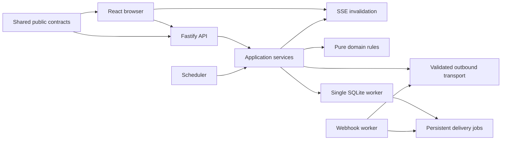
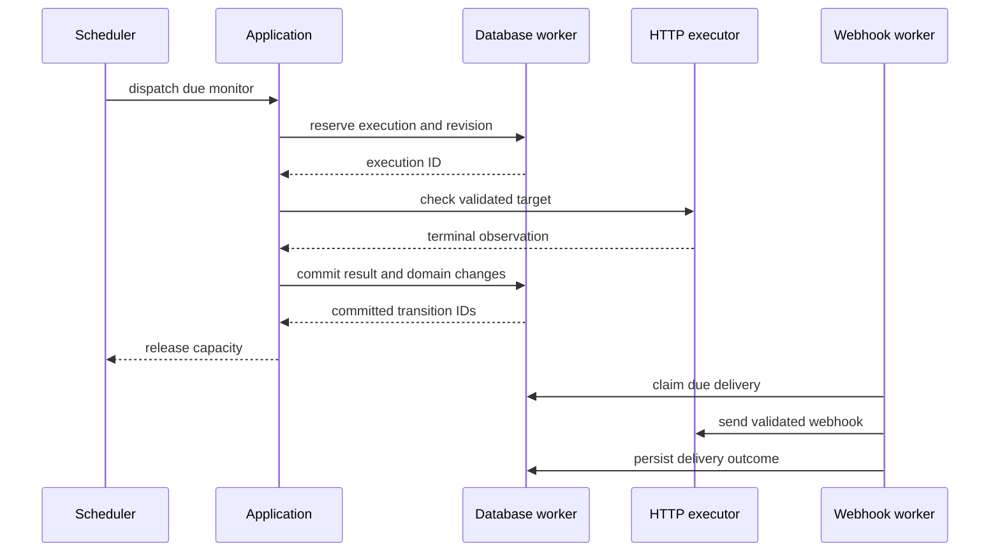

# Pulse system architecture

Normative design with Stage 1 workspaces implemented. Scope and stage ownership follow [product requirements](01-PRODUCT-REQUIREMENTS.md) and [ADRs](ARCHITECTURAL-DECISIONS.md). Runtime evidence and platform limits are recorded separately in the [Stage 1 report](../VERIFICATION.md#historical-stage-1).

## Monorepo and allowed dependencies

The implementation uses npm workspaces with this intended organization:

```text
apps/server/src/{api,config,application,domain,monitoring,scheduler,notifications,persistence,runtime}
apps/web/src/{app,features,components,lib}
packages/contracts/src/
tests/{fixtures,integration,e2e,package,performance}
docs/specifications/
docs/stages/
```

`packages/contracts` owns JSON-compatible public schemas, DTOs, enum values and inferred TypeScript types. It must not contain database access, environment reads, network calls, Node-only imports or incident logic. Fastify route validation and frontend decoding consume the same schemas. Select one schema representation and validate its Fastify compatibility in Stage 1; do not maintain independent validators.

The server domain contains pure evaluators and metric functions. Application services coordinate use cases and transactions through narrow repository/executor interfaces. Adapters implement HTTP transport, SQLite, clocks and filesystem configuration. API routes call application services; they do not issue SQL or reimplement thresholds. The scheduler dispatches application execution commands, not API requests. The frontend imports contracts and its own client helpers, never server modules. Workspaces must have no circular imports. Module folders are organization, not separately deployed services.



## Runtime and data flow

One Node.js 24 LTS process owns the local SQLite database. A dedicated worker thread owns the synchronous SQLite connection so database calls cannot block network scheduling on the main event loop. The worker is an internal implementation detail, not a second scheduler. Messages contain bounded typed commands and safe errors; a bounded FIFO queue rejects overload. No ORM, Redis, broker, external database or required cloud service is introduced.

The automatic scheduler selects an enabled due monitor, reserves one execution transactionally and calls the HTTP executor outside a transaction. On completion the result processor checks revision/epoch fencing and commits the terminal result, counters, transition, incident and, from Stage 3, notification outbox rows atomically. After commit, an in-memory invalidation may be broadcast. A lost invalidation never loses domain state; clients refetch.



Stage 1 persists checks and exposes UNKNOWN health. Stage 2 installs the pure evaluator, incidents, observation coverage and recovery. Stage 3 adds the UI, SSE and notification outbox; enabling notification code must extend the existing result transaction, not publish before commit. Stage 4 hardens and packages this architecture; it does not replace it with distributed infrastructure.

## Configuration and lifecycle

1. Parse typed startup settings, reject unknown `PULSE_` keys and load referenced secret files without echoing contents.
2. Acquire an OS-released exclusive lock for the canonical data directory. Stage 1 reserves a deterministic loopback TCP port derived from the canonical path, before writable SQLite opens; collisions fail closed. PID files are not used. See ADR-010 for measured platform scope.
3. Start the database owner, verify writable local storage, enforce pragmas, inspect schema and apply supported migrations transactionally.
4. Recover queued/running executions as ABANDONED, close prior service coverage at its last durable heartbeat and invalidate transient health context. No network work occurs before recovery commits.
5. Bind the API only after security settings pass. Register the current service run and mark readiness true when the persistence and dispatch paths are usable. Enable scheduling after readiness; dispatch due monitors once each subject to capacity.
6. On SIGINT/SIGTERM or platform-equivalent stop: mark unready, stop API mutations and new dispatch, close SSE, cancel queued/running requests, drain persistence and delivery bookkeeping, close SQLite and release the lock. Total deadline is 15 seconds; report an unsuccessful exit if draining fails.

The heartbeat is every 10 seconds from Stage 2; it is persisted once per service run, not once per monitor. Public timestamps are UTC RFC 3339; persisted instants are epoch milliseconds. Durations use a monotonic clock. Clock regressions must never create negative duration or reorder per-monitor executions; see [scheduler](06-SCHEDULER-RELIABILITY.md).

## Persistence and error boundaries

Only the database adapter executes SQL. Repository commands are typed and parameterized; no arbitrary SQL arrives from routes or worker messages. Transactions must be short and contain no network, filesystem or asynchronous callbacks. Responses acknowledging a mutation wait for its commit. Database faults pause dispatch and fail readiness rather than converting unpersisted observations into failures of the target.

Expected transport failures become safe CheckResult outcomes. Validation and conflict failures become documented API errors. Unexpected exceptions are logged with a request/execution ID and safe error code, returned as INTERNAL_ERROR, and surfaced in readiness when they affect background operation. Background promises must have explicit failure handlers. Worker death stops new dispatch and makes the process unready; recovery must not silently create a second scheduler or reset a database.

## Architectural constraints

There is one process-level scheduler, one execution pool, one SQLite owner and one separately bounded delivery pool. Delivery workers and retention cannot block scheduler capacity. Dependency count is justified by concrete needs, especially address classification, HTTP connection pinning, process locking and schema validation. A standard library facility is preferred when its runtime support and security behavior are verified. See [security](10-SECURITY-MODEL.md), [database](09-DATABASE-AND-PERSISTENCE.md) and [performance](14-PERFORMANCE-REQUIREMENTS.md).

## Stage 3 implemented adapters

The same Fastify listener serves the built React application and guarded SSE invalidations. One DeliveryWorker uses the existing database worker with reserved completion capacity and a separate bounded network pool; its HTTP transport reuses validated address classification and DNS resolution. It never occupies monitoring slots. NotificationStore owns outbox SQL and is called inside the existing incident transaction. Browser modules import shared contracts only. The local bin/pulse.mjs entry point supports start/doctor/version/help; package installation remains Stage 4.
