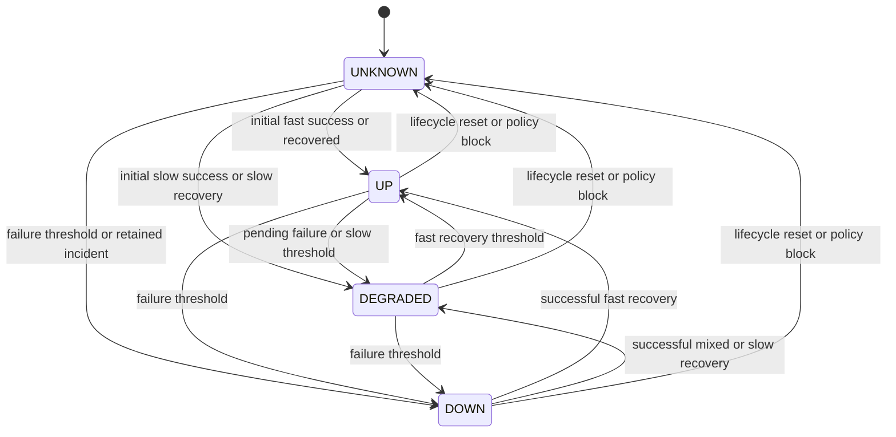

# Pulse incident state machine

Stage 2 owns this evaluator. Inputs are serialized per-monitor completed counted checks under current revision/epoch, plus explicit lifecycle resets. Stage 1 always exposes UNKNOWN. State is distinct from enabled/paused. The [monitoring engine](05-MONITORING-ENGINE.md) defines which outcomes count.

## Counters and evaluation order

Let F=failureThreshold (default 3), R=recoveryThreshold (default 2), D=degradationThreshold (default 3), and L=latencyThresholdMs (default 1000). Maintain failure, success, slow and fast consecutive counters and first timestamps of the current failure/recovery runs.

For a counted failure: increment failure; preserve/start failureRunStartedAt at the check startedAt; clear success/slow/fast and recoveryRunStartedAt. For a successful check: increment success; preserve/start recoveryRunStartedAt; clear failure/failureRunStartedAt. If duration >= L, increment slow and clear fast; otherwise increment fast and clear slow. A run of successful checks can contain both slow and fast successes; R measures reachability recovery, while fast/slow counters measure degradation.

Process one accepted execution in this exact transaction order: terminalize the check; update counters; choose new health/reason; insert a transition only if health changes; create/resolve/retain the incident; update the health projection and due time; enqueue incident events from Stage 3. Commit, then signal SSE invalidation. IDs can be allocated before insertion; use deferred relationship constraints where needed. Rollback restores all of these operations. Reprocessing a terminal execution is a no-op, not a second event.

## Complete transition table

`open` below means an unresolved incident already exists; it may coexist with UNKNOWN after pause/restart/edit. Successful classification after recovery is UP only if the current fast run >= R, otherwise DEGRADED. For initial UNKNOWN without open incident, one successful check gives UP if fast or DEGRADED if slow. Administrative reset takes precedence over any uncommitted network result.

| Current | Input/condition | Next | Incident and reason |
| --- | --- | --- | --- |
| UNKNOWN | failure, no open, failure < F | UNKNOWN | No incident; PENDING_FAILURE. |
| UNKNOWN | failure, no open, failure >= F | DOWN | Open once; FAILURE_THRESHOLD. |
| UNKNOWN | failure, open | DOWN | Reuse existing incident; FAILURE_THRESHOLD. |
| UNKNOWN | success, no open, duration < L | UP | No incident; HEALTHY. |
| UNKNOWN | success, no open, duration >= L | DEGRADED | No incident; SLOW. |
| UNKNOWN | success, open, success < R | UNKNOWN | Retain incident; RECOVERING. |
| UNKNOWN | success, open, success >= R | UP or DEGRADED | Resolve existing incident; classify fast run. |
| UP | failure, failure < F | DEGRADED | No incident; PENDING_FAILURE. |
| UP | failure, failure >= F | DOWN | Open once; FAILURE_THRESHOLD. |
| UP | success, slow < D | UP | HEALTHY; pending latency evidence is not an incident. |
| UP | success, slow >= D | DEGRADED | SLOW; no incident. |
| DEGRADED | failure, failure < F | DEGRADED | PENDING_FAILURE; no new incident. |
| DEGRADED | failure, failure >= F | DOWN | Open once; FAILURE_THRESHOLD. |
| DEGRADED | success, fast < R | DEGRADED | SLOW or RECOVERING; no incident. |
| DEGRADED | success, fast >= R | UP | HEALTHY; no incident. |
| DOWN | failure | DOWN | Retain incident; FAILURE_THRESHOLD. |
| DOWN | success, success < R | DOWN | Retain incident; RECOVERING. |
| DOWN | success, success >= R | UP or DEGRADED | Resolve once; classify fast run. |
| Any | pause, resume, target-affecting edit or restart | UNKNOWN | Clear all runs; retain unresolved incident; lifecycle reason. |
| Any | POLICY_BLOCKED completed execution | UNKNOWN | Clear runs; retain incident; POLICY_BLOCKED. |
| Any | CANCELLED, ABANDONED, stale or duplicate result | unchanged | No counter/incident evaluation; lifecycle reset may separately apply. |
| Any | rename-only edit | unchanged | Retain health/counters/incident; cancel unsettled work. |

All health pairs are reachable under an explicit condition, including DOWN to UNKNOWN under lifecycle reset. Forbidden transitions are condition violations: DOWN without an incident; any resolution without R consecutive successes; UNKNOWN/UP to DOWN below F unless an open incident is retained; DEGRADED to UP below its fast recovery threshold; and any state change caused by cancelled, stale, abandoned or uncommitted work. There is no arbitrary force-state API.

Self-loops and unchanged-state reasons are specified in the table rather than repeated in the diagram.

Stage 2 counters saturate at their configured threshold, preserving the first timestamp of the run. There is at most one transition per accepted check and none for an unchanged health state, duplicate/stale completion or partial recovery in DOWN. Flapping below recovery confirmation therefore retains one incident without repeated DOWN events. Actual confirmed state changes remain historical evidence and expire under transition retention; they are not arbitrarily suppressed.

Lifecycle reasons are PAUSED on disable, INITIAL on enable/resume, RECONFIGURED on target-affecting edit and RESTARTED on process recovery. Repeated pause/resume to the already-current enabled value is a validated no-op that does not create a fictitious transition or observation window.

## Incident timing and invariants

On the first threshold crossing without an open incident, openedAt equals first failed check startedAt in that uninterrupted run; detectedAt is the threshold-crossing completedAt. On recovery, observedEndAt equals first successful startedAt in the qualifying success run; resolvedAt equals the Rth successful completedAt. These are observations, not exact actual outage boundaries. Failures during a partial recovery clear the recovery run and extend the same incident. Latency-only degradation never opens an incident.

The partial unique index on OPEN incidents is the final duplicate guard. DOWN must reference that open incident. UP and DEGRADED have no open incident. UNKNOWN may hold one until confirmed recovery. If a conflicting open row is discovered in processing, abort the transaction and make the fault observable; never create another incident or silently merge unrelated evidence. Pause/restart/edit retains original onset/revision and introduces an observation gap; a subsequent successful recovery resolves the retained incident. Deleting the monitor removes its incident history only through confirmed deletion.

Flapping below thresholds changes pending health but creates no incident. A failed check immediately after a resolved incident starts a fresh failure run; a new incident needs F failures again. There is no notification cooldown that suppresses committed incidents, and no separate incident for each failed check. Only incident open/resolve changes enqueue webhooks; transient DEGRADED changes do not.

## Deterministic fixtures

Use F=3, R=2, D=3, L=1000; `f` is counted failure, `h` fast success, `s` slow success. A fixture records every check start/completion and asserts counters, state, timestamps, transition IDs, incident count and outbox count.

| Start/context | Input | Expected result |
| --- | --- | --- |
| UNKNOWN, no incident | f, f | UNKNOWN; failures 2; no incident. |
| UNKNOWN, no incident | f, f, f | DOWN; one incident opened at first f start and detected at third f completion. |
| UNKNOWN, no incident | h | UP. |
| UNKNOWN, no incident | s | DEGRADED, no incident. |
| UP | f, h, h | DEGRADED, DEGRADED, UP; zero incidents. |
| UP | s, s, s, h, h | UP, UP, DEGRADED, DEGRADED, UP; zero incidents. |
| DOWN, open | h, f, h, h | DOWN, DOWN, DOWN, UP; same incident resolves at last completion, observedEnd at third input start. |
| DOWN, open | s, s | DEGRADED; incident resolved, latency remains degraded. |
| DOWN, open | h, s | DEGRADED; successful recovery is mixed. |
| DOWN then pause/resume | h, h | UNKNOWN after reset, UNKNOWN then UP; same incident resolved, paused gap excluded. |
| DOWN then restart | f | UNKNOWN then DOWN; existing incident reused. |
| UP | POLICY_BLOCKED, f, f, f | UNKNOWN, UNKNOWN, UNKNOWN, DOWN; policy block was not a failure sample. |
| Any | stale completion / cancelled / abandoned | No domain change from the result. |
| UNKNOWN, F=1 | f | Direct DOWN and one incident. |
| DOWN, R=1 | h | Immediate UP and one resolution. |

Test rollback after each transactional step, simultaneous manual/automatic requests, edits during response completion, deletion during execution and repeated commit messages. See [database](09-DATABASE-AND-PERSISTENCE.md) and [analytics](08-METRICS-AND-ANALYTICS.md).
