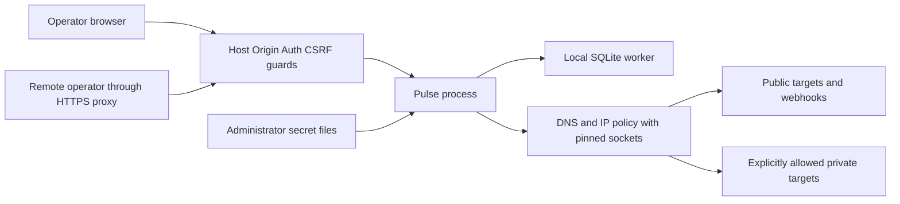

# Pulse security model

## Overview

This is the mandatory security contract for Pulse, originating before implementation. Stage 1 has a backend and controlled runtime tests; [its report](../STAGE-1-REPORT.md) identifies what was exercised. Stage 2 strengthens the Windows remote secret-file guard: an unavailable ACL probe now rejects startup, rather than accepting unverifiable permissions. Existing PowerShell 7 is preferred with built-in Windows PowerShell as an absent-executable fallback; the script is fixed, the path is passed only through the child environment and execution is bounded. Later-stage controls remain requirements, not verified safeguards or vulnerability findings. This model is scoped to this workspace and is not an independent security-scan result.

An independent read-only architecture review examined specifications 02–09. Its identified design conflicts in the policy reason enum, login bootstrap, local SSE, metric disclosures and delivery/incident retention were reconciled in these contracts. This review establishes design consistency only; it is not runtime security-audit coverage.

Pulse runs one operator-controlled Node.js process with a local SQLite worker and same-origin browser UI. Default operation is loopback-only. Conditional remote operation uses an authenticated operator session/token and an HTTPS reverse proxy. Monitoring and webhook transport can contact configured destinations, creating the most important egress boundary. There is no tenant boundary or untrusted plugin execution.

| Component | Design source | Security responsibility |
| --- | --- | --- |
| Startup/configuration | [Architecture](02-SYSTEM-ARCHITECTURE.md), [models](03-DOMAIN-MODELS.md) | Validate exposure, secret references and exclusive database ownership. |
| Fastify and session layer | [API](04-API-CONTRACTS.md) | Authentication, Origin/Host/CSRF, schemas and limits. |
| HTTP transport | [Engine](05-MONITORING-ENGINE.md) | Destination validation, actual-IP pinning and TLS. |
| SQLite worker | [Database](09-DATABASE-AND-PERSISTENCE.md) | Parameterized commands, atomic invariants and bounded work. |
| Browser and delivery worker | [Frontend](12-FRONTEND-ARCHITECTURE.md), [notifications](11-NOTIFICATION-SYSTEM.md) | Safe rendering, secret-free events and bounded delivery. |
| Release operator | [Release](15-RELEASE-AND-DISTRIBUTION.md) | Validate immutable archive and exact publication authorization. |

| Deployment or workflow | Resource/capability | Configuration and precedence | Safe effective value/location | Readers/writers/recipients | Enforcing control | Evidence or unknowns |
| --- | --- | --- | --- | --- | --- | --- |
| Default local startup | API listener | Explicit PULSE_HOST/PORT, otherwise defaults | 127.0.0.1:3000 | Same-host operator/browser | Loopback bind plus exact Host/Origin | Stage 1 controlled listener tests; release deployment remains unverified. |
| Remote startup | Operator API and sessions | Exposure=remote, explicit HTTPS public origin, token file, trusted proxy CIDRs | HTTPS public origin; backend loopback or protected bind | Authenticated operator, configured proxy | Fail-closed startup/auth/CSRF and proxy allowlist | TLS termination is an operator responsibility. |
| Either mode | SQLite database | PULSE_DATA_DIR, canonicalized once | `<dataDir>/pulse.sqlite`, same-host storage | Pulse process and host administrator | OS permissions, exclusive directory lock, one DB worker | Windows ACL and lock adapters need platform tests. |
| Remote login | Operator token | PULSE_AUTH_TOKEN_FILE only | Administrator-provisioned file, raw value never exported | Process and administrator | File checks, constant-time comparison, rate limit | Host compromise exposes local secrets. |
| Webhook delivery | URL/signing keys | PULSE_SECRETS_DIR plus validated aliases | `<secretsDir>/<alias>.url` and `.key` | Process and administrator; URL recipient gets intended event | Realpath containment, bounded files, write-only APIs | Files provisioned outside browser UI. |
| Public-only egress | Remote request socket | PULSE_EGRESS_POLICY default | Globally routable validated/pinned address | Configured public target | Full A/AAAA classification, TLS, redirect revalidation | Network routing remains a host trust assumption. |
| Private egress opt-in | Internal request socket | allow-private plus explicit CIDRs | Only specifically permitted private/loopback ranges | Operator-approved internal target | Same transport controls plus narrow allowlist | This intentionally grants scoped internal reachability. |
| Publication | Public npm/release artifacts | Validated archive digest plus explicit user authorization | Exact approved candidate, no private instructions/data | Public recipients | Allowlist, archive inspection, fresh install and approval | No publication is authorized by this task. |

## Threat model, trust boundaries and assumptions

Assets: integrity of checks/incidents/metrics, operator access token and sessions, webhook URL/signing keys, monitor target metadata, local database/backups, host/network resources, and integrity of public release artifacts. A compromised operator account has broad Pulse configuration authority; this is a single-operator application, not RBAC.

Attackers may control an internet page opened in the operator browser, remote unauthenticated HTTP input when remote mode is configured, monitored DNS/HTTP/redirect responses, webhook responses or a malicious dependency. They are not assumed to own the operator token, host administrator account, secrets directory or authorized release credentials. A malicious target must not turn Pulse into an internal scanner or consume unbounded memory. A browser origin must not gain operator authority merely because the backend is on localhost. Host administrators can already read data and secrets; Pulse cannot isolate itself from them.

Mandatory trust-boundary controls:

- **Exposure and auth:** bind 127.0.0.1 by default; reject non-loopback binds in local mode. Remote mode requires a token file, explicit HTTPS public origin and documented HTTPS proxy/network protection. Never accept a flag to expose anonymously. A declared HTTPS origin cannot prove that a proxy is configured correctly; Stage 4 verifies the actual deployment path. Trust forwarded IP/protocol/host only from configured proxy CIDRs; never trust arbitrary X-Forwarded-*.
- **Browser access:** validate Host against the configured public-origin authority on all routes, including health. Reject missing/mismatched Origin on browser mutations; require application/json and no permissive CORS. Cookie-authenticated mutations additionally need a cryptographically random session-bound CSRF token. No wildcard origins, reflected origins or credentialed cross-origin access. Non-browser bearer requests may omit Origin, but a supplied Origin must match. Do not accept tokens in query strings.
- **Session lifecycle:** operator tokens have at least 32 random bytes and are compared in constant time. Session IDs and CSRF tokens use at least 32 random bytes; keep only server-side session state, cap 100 active sessions and expire after 8h without sliding extension. Cookies are HttpOnly, SameSite=Strict, Path=/; Secure in remote mode. Local HTTP authenticated deployments use a non-Secure cookie only on loopback. Rotate token by replacing its file and restarting; all sessions are invalidated. Login attempts follow API rate limits.
- **Input and storage:** validate all path/query/body/worker boundaries, reject extra fields and cap payloads. Use parameterized SQL and allowlisted sort columns. Never render monitor names or error text as HTML, execute URLs or enable user-defined scripts. No dynamic evaluation or shell execution from input. Transaction/fence constraints protect state integrity independently of frontend validation.
- **Secrets:** accept file paths/references, never token values in CLI/environment. Alias matching and canonical realpath containment prevent traversal and symlink escape; only bounded regular files (at most 4KiB) are read. Check owner-only POSIX permissions or equivalent Windows ACLs where available; remote startup must reject clearly world-readable secret files. Document unverifiable ACL checks explicitly. Keep secrets outside static roots, source control, backups intended for sharing and test artifacts. Never return alias contents, submitted token values, webhook bodies, full target URLs or Authorization/Cookie headers in logs/errors/SSE.
- **Logging:** allowlist safe fields: request/execution/incident IDs, safe error codes, outcome enums, counts and durations. Do not log complete request/response objects, raw exception messages, DNS answers, user-provided names or secrets. Debug level never bypasses redaction. Canary tests cover nested errors and worker serialization.
- **Rendering:** React text escaping, no dangerouslySetInnerHTML for target data, no external target content preview. Serve a restrictive CSP (default-src none; script/style/connect/font/img from self as required; images may use data only for owned assets; object-src none; base-uri none; frame-ancestors none; form-action self), X-Content-Type-Options nosniff and Referrer-Policy no-referrer. Inline scripts/styles require a reviewed nonce/hash path; no blanket unsafe-inline exception. UI links to targets use rel=noopener noreferrer and only validated http/https URLs.
- **Dependencies and configuration:** pin reproducible versions with lockfile, review licenses/advisories before release, and evaluate transitive supply-chain changes. Do not assume that a successful install proves safety. Disable ambient HTTP_PROXY/HTTPS_PROXY use in the outbound transport. The host firewall is defense in depth, not a replacement for application egress controls.

### Mandatory SSRF policy

Parse with one canonical URL implementation. Allow only http/https; reject credentials, malformed/ambiguous IP forms, fragments and monitor query strings. Normalize IDNA hostnames and IPv4/IPv6 literals, including IPv4-mapped IPv6. Default public-only mode permits only globally routable unicast destinations. Deny loopback, RFC1918/ULA, link-local, carrier-grade NAT, multicast, unspecified, documentation/test/reserved and other non-global ranges using a maintained tested address classifier, not a few string prefixes.

An explicitly configured private CIDR can permit private/loopback addresses in allow-private mode. Unspecified, multicast, link-local and cloud metadata destinations remain forbidden even with a broad allowlist. Include known metadata hostnames and special addresses in permanent deny tests. Public egress may use only ports 80/443; nonstandard ports require an explicitly approved private/loopback CIDR target. Reject an entire DNS answer set if any answer is forbidden. Validate again for every new connection and redirect, dial the validated address directly, and preserve TLS hostname verification. Deny HTTPS downgrade. Webhook redirects are never followed.

DNS pinning prevents lookup/connect rebinding; it cannot prevent an administrator-controlled routing/NAT change or a permitted public server acting as its own proxy. A globally routable compromised target remains a permitted recipient of the intended minimal HTTP request. Private access intentionally increases exposure; administrators must avoid broad CIDRs and services with side effects on GET/HEAD.

## Attack surface, mitigations and attacker stories

These are prioritized design hypotheses, not validated vulnerabilities. Every control requires the linked test suite; no table entry asserts a current exploit.

| Priority | Scenario and capability gain | Prerequisites | Impact | Required controls | Mitigation / verification | Design evidence |
| --- | --- | --- | --- | --- | --- | --- |
| High | Target DNS/redirect changes to an internal address, giving target operator unauthorized network reach | Operator configured attacker-controlled public target | Internal data exposure or service actions | All-answer validation, socket pinning, redirect checks, permanent metadata denial | DNS rebind and actual-socket fixture must show zero denied connections | [Engine](05-MONITORING-ENGINE.md) |
| High | Internet page sends mutations to loopback Pulse with operator browser authority | Operator visits attacker page while Pulse runs | Monitor/destination changes, data deletion | Exact Host/Origin, JSON-only mutations, cookie CSRF, no CORS | Cross-origin form/fetch and DNS-rebinding browser tests | [API](04-API-CONTRACTS.md) |
| High | Remote unauthenticated client reads or mutates operator data | Remote deployment exists | Full Pulse operator access | Fail-closed exposure/auth, bounded login, trusted proxy settings | Direct and proxied startup/auth matrix | [Models](03-DOMAIN-MODELS.md) |
| High | Alias or symlink escapes secrets root and reads an unrelated file | Authenticated API can set destination references | Disclosure through delivery or errors | Strict aliases, realpath containment, regular bounded files, no raw errors | Traversal/symlink/Windows-path tests | [Notifications](11-NOTIFICATION-SYSTEM.md) |
| High | Sensitive URL/token leaks into logs/events/archive | Any configured secrets | Credential exposure | Safe-field logging, masked DTOs, archive allowlist | Canary scan against final outputs and tarball | [Release](15-RELEASE-AND-DISTRIBUTION.md) |
| Medium | Controlled server stalls headers or floods responses | Permitted configured target | Check starvation/resource exhaustion | Absolute timeout, header cap, no body buffering, bounded pools | Slow/infinite-body fixtures and saturation measurements | [Scheduler](06-SCHEDULER-RELIABILITY.md) |
| Medium | Malicious names/query fields inject HTML/SQL | Operator/compromised input path | Browser session misuse or corrupted data | Escaped text, schemas, parameterized SQL, sort allowlist, CSP | XSS/SQL canary tests through persisted API/UI | [Frontend](12-FRONTEND-ARCHITECTURE.md) |
| Medium | Crash/replayed completion opens duplicate incidents or sends wrong event | Process failure or internal callback races | Misleading monitoring/notifications | Unique constraints, revision fencing, transactional outbox | Rollback and kill/restart harness | [Database](09-DATABASE-AND-PERSISTENCE.md) |
| Medium | Webhook receiver returns retries forever or attempts redirect escalation | Configured destination | Delivery resource drain/egress abuse | Five attempts, independent pool, redirect denial, policy per attempt | Real receiver with backoff and dead-letter assertions | [Notifications](11-NOTIFICATION-SYSTEM.md) |
| High | Candidate substitution exposes private data or unvalidated code publicly | Authorized release workflow plus compromised artifact path | Public compromise/disclosure | Immutable digest, fresh install, archive inspection, exact release authorization | Verify digest immediately before publication | [Release](15-RELEASE-AND-DISTRIBUTION.md) |

Residual risks: administrator/host compromise, malicious trusted dependency, outbound routing outside application control, physical storage failure, operator-approved private reachability, repeated observational GET/HEAD side effects, finite notification retries and single-host downtime. There is no guarantee against internet-scale DDoS or global outage blindness. Open implementation questions are the exact cross-platform lock/ACL adapter, validated HTTP/DNS address-classification implementation and tested SQLite patch release; they are bounded Stage 1 decisions to record in ADRs, not missing product authorization.

## Severity calibration (Critical, High, Medium, Low)

Critical would require demonstrated broad unauthenticated remote compromise of the host or release chain with severe privilege gain; the design does not establish such a finding. High examples include unauthenticated remote operator takeover or proven metadata credential theft through default egress controls. A caller already holding the configured operator token does not gain new operator privilege by editing monitors.

Medium examples include bounded authenticated data corruption, persistent XSS with meaningful operator impact, or resource starvation that requires a configured malicious target. Default SSRF that reaches privileged host services can be High depending on demonstrated reachability/impact. Low examples include limited metadata exposure without credentials or meaningful control. Intended local-administrator access and explicit narrow private-target access are not vulnerabilities by themselves. Severity and confidence are separate; absent source/runtime evidence lowers confidence and leaves a hypothesis, not a fabricated result.
